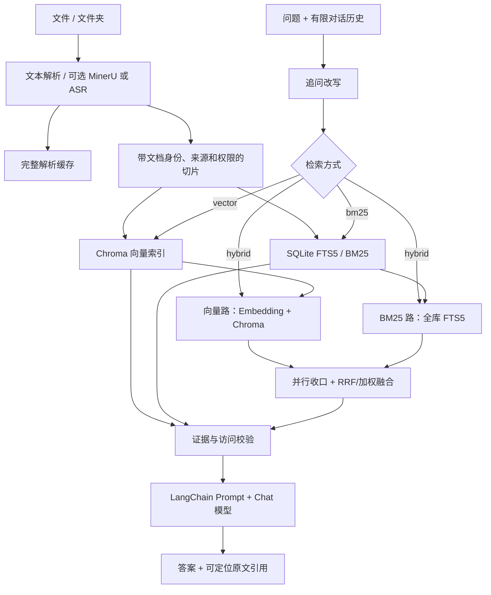

# DocuMind · 可追溯的本地 RAG 知识库

一个面向中文文档的单人 RAG 演示项目：从导入、解析、切片和检索，到带原文引用的多轮问答，再到索引维护与检索评估。重点是把数据来源、任务状态和失败处理做清楚，方便复现和讲解。

**实现边界：**Python 标准库 Web 服务 + LangChain + Chroma + SQLite FTS5/BM25 + 原生 JavaScript。主 Web 后端尚未迁移 FastAPI；可选本地向量服务使用 FastAPI/Uvicorn。混合检索使用向量与全库 BM25 双路并行召回，任一路失败时显式降级并保留脱敏诊断。当前没有 LangGraph 编排或 Dockerfile/Compose，不把计划当成已实现功能。

## 可以展示什么

| 能力 | 实现与取舍 |
|---|---|
| 带证据的多轮问答 | 追问改写后检索；回答保留 `chunk_id` 引用，可跳转到原文位置；任务展示编码、检索、生成阶段 |
| 三种检索方式 | 向量检索、独立 BM25 检索，以及向量与全库 BM25 双路并行召回后 RRF/加权融合；单路失败时显式降级，并提供可复制的脱敏诊断 |
| 文档导入 | PDF / Markdown / TXT；桌面浏览器可选文件、文件夹或拖拽，递归收集支持的文件，不支持的类型提示跳过；超过每批 10 个自动分批 |
| 解析复用 | 普通文本直接处理；复杂版面可选 MinerU，内容缓存避免相同文件重复解析；扫描件 OCR、音视频 ASR 需另外配置 |
| 安全重建索引 | 复用切片、复用完整解析文本重新切片、强制/必要时重解析；独立目录构建，全部校验后原子切换；失败保留旧库 |
| 索引生命周期 | 正常保留当前与上一成功版本；关闭同目录所有缓存客户端后清理失败/更早版本；受阻时保留错误和清理待办 |
| 可操作的任务与设置 | 上传/重建任务持久化；上传逐文件进度、取消与失败重试；设置按节保存/放弃，真实请求反馈；单控件搜索选择，搜索草稿不等于模型变更 |
| 文档管理 | 当前列表多选批量删除，共享单条硬删除语义并统一更新 BM25；保留服务器原文件和解析缓存；管理员权限和知识库范围校验 |
| 评估与审计 | Hit@K / MRR / Recall@K、正文指纹重新锚定、失效标注报告、快照指纹校验与逐题比较；索引变更留审计记录 |

还提供访问组、待审核上传、用户管理，以及基于召回样本的语义聚合统计。它们是演示能力；项目未做多人压测、分布式任务或生产安全认证。聚合统计是样本估计，不代表全库精确计数。

## 核心流程



后台重建复用当前文档清单，在新版本内完成向量、BM25、模型清单、数量检查及评测重新锚定，再一次原子提交生效路径与配套配置。保存目标模型后，旧索引模型不一致时向量路会失败；混合检索可降级为 BM25，但页面会持续显示降级原因和排查建议，管理读取继续可用，禁止混用向量。

## 快速开始：两份自编资料

要求 macOS 或 Linux（POSIX），Python 3.10+，索引维护需系统提供 `lsof`；前端检查另需 Node.js。从**全新克隆**开始，避免把示例配置覆盖到已有知识库。

```sh
git clone https://github.com/ibhYin/BM25_VectorDB_RAG.git
cd BM25_VectorDB_RAG
python3 -m venv .venv
source .venv/bin/activate
python -m pip install -r requirements.txt
cp .env.example .env
mkdir -p data/raw
cp -n examples/documents/* data/raw/
```

示例配置使用本地 Ollama 的 [qwen2.5:1.5b](https://ollama.com/library/qwen2.5:1.5b) 和 [bge-m3](https://ollama.com/library/bge-m3)。安装并启动 [Ollama](https://docs.ollama.com/api/openai-compatibility) 后，另开终端准备模型：

```sh
ollama pull qwen2.5:1.5b
ollama pull bge-m3
ollama serve
```

若桌面 Ollama 已在运行，不重复执行 `serve`。首次下载需要网络、磁盘及模型运行内存；这组模型用于短示例，不承诺硬件性能或回答质量。`ollama` 是本地兼容接口的 SDK 占位值，不是真实 API 密钥。也可以在 `.env` 配置已有的 OpenAI 兼容 Chat/Embedding 服务，二者可独立设置端点、模型和密钥；云端调用可能计费。

回到项目终端，首次入库并整理到受管理目录，再启动服务：

```sh
python -m app.main ingest
python -m app.main maintain-indexes --migrate-legacy
python -m app.main ask "星河项目的试用期是多少天？"
python -m app.main web --host 127.0.0.1 --port 8000
```

手动访问 <http://127.0.0.1:8000>。示例答案应根据原文回答“14 天”，并带上证据引用；点击引用核对原句。另有三个可核对问题在 [examples/evaluation.json](examples/evaluation.json)。

- `ingest` 写入 `.env.example` 配置的首次 `.chroma` 目录；离线维护只移动已有索引并原子保存新路径，不重新解析或向量化。之后运行配置接管生效目录，无需手改路径。
- `config/runtime_config.json` 优先于 `.env` 中同名字段。复现请使用新克隆，不能直接复制别人已保存的运行配置或私人向量库。
- 默认没有访问策略时是本机开放模式，管理功能可用；保持 `127.0.0.1` 监听。不要把此模式直接暴露到公网。
- 初次 Markdown/TXT 演示不使用 MinerU/OCR/ASR。PDF 结构化需自行提供 MinerU token；扫描件 OCR 需要可用视觉服务；音视频还需 `ffmpeg` 与转写配置，相关服务可能计费。

### 可选：启用登录与访问组

复制 [权限示例](config/access_policy.example.json) 到 `config/access_policy.json`；其中的账号只是策略身份，没有预置密码。停服后，可用以下命令在**不存在认证文件的新环境**建立管理员密码和随机会话密钥：

```sh
cp -n config/access_policy.example.json config/access_policy.json
python - <<'PY'
import json, os, secrets
from getpass import getpass
from pathlib import Path
from app.web_auth import hash_password
path = Path('config/web_auth.json')
password = getpass('设置 demo-admin 密码（至少 8 位）: ')
if len(password) < 8:
    raise SystemExit('密码至少 8 位')
payload = {'secret': secrets.token_urlsafe(32), 'users': {
    'demo-admin': {'password_hash': hash_password(password)}
}}
# 独占创建，已有认证文件不会覆盖。
fd = os.open(path, os.O_WRONLY | os.O_CREAT | os.O_EXCL, 0o600)
with os.fdopen(fd, 'w') as output:
    json.dump(payload, output)
PY
```

重启后用自己设置的密码登录，在“用户”页创建其他账号、设置访问组。登录账号需同时存在于权限策略与认证文件。上述两个运行文件均已忽略，不能上传；API 密钥在本机运行配置中明文保存，页面不回显密钥。

## 页面与最短验收

| 页面 | 手动检查 |
|---|---|
| 问答 | 用星河示例提问，查看阶段、证据及引用跳转；再追问，检查问题改写 |
| 知识库 | 导入两份公开样例；展开任务明细，刷新后不应被轮询自动折叠；勾选文档查看明确的批量删除范围 |
| 设置 | 修改一节并保存，其他节未保存输入保留；搜索后不选择或重选同一模型不应产生变更；刷新模型列表有真实数量/错误反馈 |
| 评估 | 人工确认证据后标注，查看失效标注与运行快照 |
| 审计 / 用户 | 启用策略后检查管理员入口与权限反馈 |

重建前确认会显示当前知识库、文档数、原/目标模型和复用策略；失败应保留旧索引与原因。删除确认明确“删索引、保留原文件和解析缓存”。这些改变真实数据的动作只在新建的示例知识库验收。

仓库目前不附私人语料截图；可按 [示例说明](examples/README.md) 手动制作脱敏截图。流程图和功能表用于说明实现，不替代实际界面验收。

## 检索评估与量化口径

公开样例是 **2 份自编文档、4 个参考问题**，用于复现流程，不能据此宣传检索准确率提升。当前没有随仓库发布经人工核验的质量提升基准，不使用缺乏证据的 Hit@5、MRR 或端到端延迟数字。

保留评测路径：对真实语料准备问题，收集向量/BM25/混合检索证据的并集并人工标注；固定语料、标注和模型配置，记录比较快照。先查看结果，再把实际 `chunk_id` 写入标注：

```sh
python -m app.main retrieve "星河项目的试用期是多少天？" --method hybrid --top-k 5
# 将下面占位符换成上一条结果里人工确认的真实 chunk_id
python -m app.main eval label "星河项目的试用期是多少天？" --relevant '<实际chunk_id>'
python -m app.main eval run --method vector --k 1,3,5 --save reports/vector.json
python -m app.main eval run --method hybrid --k 1,3,5 --save reports/hybrid.json
python -m app.main eval compare reports/vector.json reports/hybrid.json
```

只检索不调用 Chat 生成，但向量/混合检索仍会调用 Embedding；更换为云端服务后仍可能计费。启用权限时根据需要加 `--user-id demo-admin`。

指标以排名为依据，未标注或失效标签会明确报告并剔除。正文指纹用于重建后的重新锚定；语料/标注指纹变化时默认拒绝直接比较。标注不完整只能评价已确认的证据，不能代表总体召回率。示例过小、Top-K 接近全集时不适合评价算法收益；扩充问题集后再报告量化结果，并注明模型、语料、题数、人工标注与环境口径。

## 验证

```sh
python -m pytest -q
node tests/test_job_details.cjs
node tests/test_form_controls.cjs
node tests/test_settings_sections.cjs
```

测试使用临时目录与模拟模型，不覆盖真实索引，不访问收费模型。覆盖模型不一致管理读取、安全重建与失败保留、版本清理/连接关闭、文档范围与权限、缓存保留、评测锚定、设置隔离、搜索选择与真实反馈等。公开样例首次入库与问答另有 `tests/test_public_demo.py` 检查；它模拟模型，不能证明真实服务可用或回答质量。

## 目录与部署

```text
app/                     CLI、标准库 HTTP 服务、后台任务、权限与评估
app/web_static/          原生 HTML/CSS/ES 模块，无前端构建步骤
rag/                     加载、缓存、切片、Chroma、BM25 与检索
chains/                  LangChain Prompt、回答/改写/聚合调用
examples/                自编公开资料与参考证据
deploy/                  需替换域名/路径的 systemd / Nginx 示例
scripts/                 可选本地向量服务与 macOS 启停脚本
tests/                   临时数据、模拟服务的回归检查
data/                    本机数据说明及被忽略的运行数据
docs/                    被忽略的临时协作记录，不作为发布文档
```

[部署模板](deploy/) 展示 Linux systemd 管理 Web/可选向量服务以及 Nginx 反向代理，配置中的域名/IP 为占位符，不能直接当作已验证部署。`requirements-server.txt` 和 `requirements-embedding.txt` 是特定环境/独立向量服务的依赖；常规本地运行使用 `requirements.txt`。可选向量服务的 FastAPI/Uvicorn 不等于主 Web 后端已经迁移，Docker 容器化也尚未实现。

macOS 的 `scripts/start_web.command` 会自动打开 Chrome；只需启动后端时使用上文 CLI 命令。脚本不属于自动检查的执行范围。

## 运行数据与限制

- 原文件、索引、解析缓存、任务、对话、认证、策略、审计和评测报告不随 Git 发布；详见 [.gitignore](.gitignore) 与 [数据说明](data/README.md)。不提交他人私人资料。
- 同一实例服务一个知识库；索引模型按清单校验，模型变化需独立重建。CLI `ingest --rebuild` 是旧切片清理能力，不是跨模型迁移。
- 保留的旧版本是历史快照，不会同步后来上传或删除；没有“无条件安全回滚”的承诺。
- 清理使用本机 POSIX 文件锁和 `lsof`；占用、归属不明、越界或符号链接会保留待办。停服后 `python -m app.main maintain-indexes` 可重试，不重新调用模型。
- 混合检索的向量路和 BM25 路并行执行；任一路抛异常时使用另一条正常完成的路，并在问答页和对话历史中保留降级状态。正常空命中不视为失败。
- 上传/重建在后台执行；任务轮询是单人演示规模方案，未做压测。不是高可用、分布式或生产部署方案。
